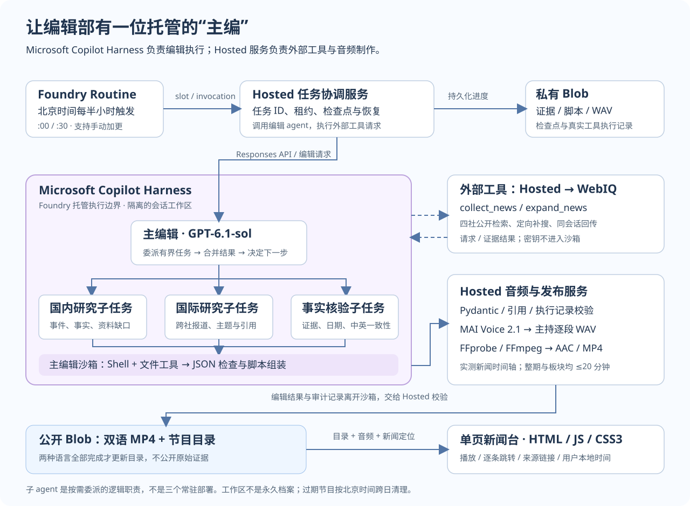
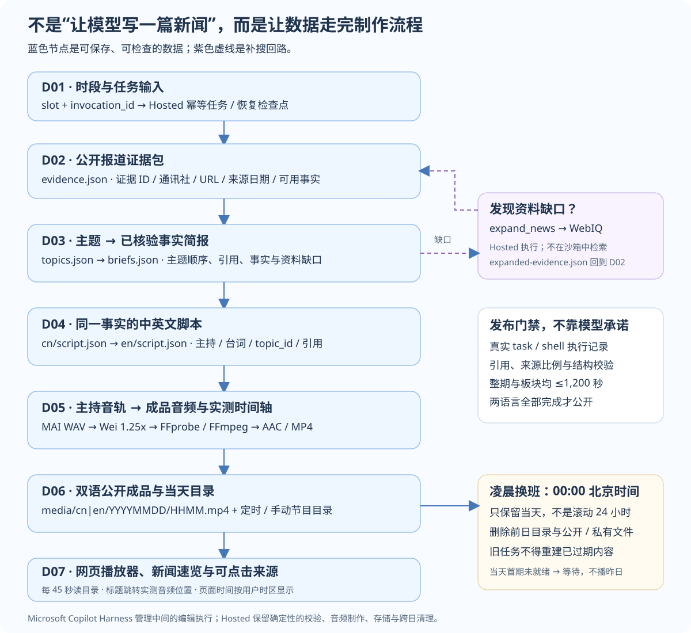

# 从“会写稿”到“会值班”：用 Microsoft Copilot Harness 打造一个 24 小时新闻台

> 一个技术布道师眼中的实践故事：让 AI 不只回答问题，而是参与一条可恢复、可检查、可发布的工作流。
>
> 本文基于 Meridian 24 项目的实际实现与截至 2026 年 11 月 1 日的官方资料。Microsoft Copilot Harness 和 MAI Voice 2.1 目前均为公开预览，相关文档明确提示没有预览功能 SLA、不建议用于生产工作负载。“24 小时”是本项目的应用设计目标，不是商业服务可用性承诺。

想象这样的晚上：你打开手机，一男一女两位主持正在连贯地播报新闻。屏幕底部滚动着标题与时间。点击某条标题，声音立即跳到那条新闻；点击旁边的来源，则打开原报道。切换到英文，听到的是同一组事实，而不是另外一份新闻清单。

这就是我们想做的 Meridian 24：每半小时更新中国国内与国际新闻，提供中英文音频，用一个 HTML、JavaScript、CSS3 页面呈现。

听起来，好像只是“搜索新闻，再让模型写稿，最后转成语音”。

真正开始做，才发现难点不是让 AI 开口，而是让这座小小的编辑部持续、可靠地工作。

## 1. 为什么要引入 Microsoft Copilot Harness？

### 第一份稿件的问题，不是文笔，而是工作方法

如果直接把一堆标题交给模型，结果很容易变成一串互不相干的摘要。有些报道只有标题，没有足够细节；模型却可能用评论补齐篇幅。某家通讯社更容易被检索到，整期节目又会不知不觉被它占满。

这时，继续修改一句“请写得更专业”，帮助有限。

我们真正需要的是一套编辑流程：先采集公开报道，再合并主题；找出资料缺口，必要时补搜；整理有证据的事实，最后才写成连贯的双主持脚本。

**模型像一位能干的编辑，但编辑部还需要工作台、资料柜、任务分工和交接制度。**

Microsoft Copilot Harness 提供的正是其中的托管执行基础：Microsoft Foundry 运行 agent loop 与沙箱，协调模型和工具步骤，支持内置子 agent、文件操作以及可复用 skills 等能力。[1][2]

换句话说，开发者不必先把“编辑部的所有办公设施”都造一遍，才能开始研究如何把新闻讲清楚。

### 还有一个问题：22:30 的任务，不能因为一次中断就从头来过

制作节目需要检索、整理、多轮编辑、语音合成和音频编码。已经合成了十段语音，服务却中断了，难道要把十段再付费生成一次？

这里要分清两个能力：

**Microsoft Copilot Harness** 管理托管编辑运行时；**Hosted Agent 的长任务恢复能力** 提供中断后重新执行的基础。保存哪些进度、如何复用成品、如何避免重复发布，仍然是应用代码的职责。[1]

因此，我们没有把整座电台塞进一个提示词，也没有把“托管”理解为“什么都不用做”。

## 2. 如何利用 Microsoft Copilot Harness 构建应用？

### 我们选择了一种分工：托管主编，保留音频制作间

已有的 Hosted 服务擅长执行 WebIQ 请求、调用语音接口、运行 FFmpeg 和写入 Blob。与其重写它，不如让它继续负责这些确定性的工作，再新建一个使用 Microsoft Copilot Harness 的 Prompt Agent，接管新闻研究与编辑。



*图 1：紫色区域是托管编辑执行边界。WebIQ 请求与音频制作在外部 Hosted 服务执行；重要结果保存到 Blob，而不是依赖沙箱永久存在。*

这条边界很重要：

Microsoft Copilot Harness 负责“如何研究、整理、委派和写稿”；Hosted 服务负责“如何调用外部接口、校验、合成和发布”。

在当前公开预览中，不能直接给已有 agent 切换运行时。我们创建独立的编辑 agent，保留原 Hosted Agent 的类型与职责。[2]

下面是本项目定义的精简节选，省略了完整编辑指令和自定义新闻工具：

```yaml
kind: prompt
name: newsradio24-editor
model: gpt-6.1-sol
harness:
  type: microsoft_copilot_preview
tools:
  - type: microsoft_copilot_toolset_preview
    defaultConfig:
      enabled: false
    configs:
      - name: filesystem_read
        enabled: true
      - name: filesystem_write
        enabled: true
      - name: shell
        enabled: true
      - name: subagents
        enabled: true
```

这里的 `gpt-6.1-sol` 是本项目使用的模型部署名，不意味着所有项目都可以直接选用它。实际部署时，应选择自己项目所在区域支持、且已经部署的模型。完整定义见 [newsroom.yaml](../agents/newsroom.yaml)；公开预览字段与工具支持范围以官方文档为准。

### 子 agent 不是“三位新主持”，而是后台编辑分工

前台仍然只有男女两位主持。后台则把工作拆成三类逻辑职责：

| 子任务职责 | 收到什么 | 交回什么 |
| --- | --- | --- |
| 国内研究 | 中国国内报道及证据 ID | 合并后的事件、事实、资料缺口 |
| 国际研究 | 国际报道及跨社来源 | 主题顺序、引用、需要补搜的内容 |
| 事实核验 | 扩展证据、简报或脚本 | 引用检查、冲突与双语一致性问题 |

主编辑按阶段有界委派，再合并结果。本站每次编辑请求最多允许三个子任务；这不是三个额外部署、永远在线的服务，也不要求每个阶段都固定创建相同的三位“员工”。

沙箱像编辑的临时工作台：用 Shell 和文件工具整理 JSON、检查证据 ID 与主题顺序。它的工作区按会话隔离，但不能当成永久档案，重要输出需要保存到持久存储。[2]

本站目前通过版本管理的指令与请求级 procedure 描述编辑方法，**尚未把它们单独发布为 Foundry Skill**。可复用 skills 是 Microsoft Copilot Harness 支持的扩展方向，不应把平台能力误写成本项目已经完成的功能。

### 工具带来证据，不把密钥带进工作台

主编辑通过 `collect_news` 和 `expand_news` 发起采集、补搜。它们接受空参数对象；新闻窗口与上下文由服务端绑定，WebIQ 密钥留在 Hosted 服务。

收到外部函数请求后，Hosted 执行检索，把结果作为 `function_call_output`，用对应的 `call_id` 返回同一会话。这样，编辑能继续工作，又不需要接触凭据。

下面只展示编辑请求的入口，不是完整工具执行循环。`payload` 包含该阶段的 procedure、证据和输出契约：

```python
import json
import os
from azure.ai.projects.aio import AIProjectClient
from azure.identity.aio import DefaultAzureCredential

async def request_editor(payload):
    async with (
        DefaultAzureCredential() as credential,
        AIProjectClient(
            endpoint=os.environ["FOUNDRY_PROJECT_ENDPOINT"],
            credential=credential,
            allow_preview=True,
        ) as project,
        project.get_openai_client(
            agent_name="newsradio24-editor",
            timeout=900,
            max_retries=2,
        ) as client,
    ):
        conversation = await client.conversations.create()
        return await client.responses.create(
            conversation=conversation.id,
            input=json.dumps(payload, ensure_ascii=False),
        )
```

项目使用 `azure-ai-projects` 2.9.0。端点从自己的服务端环境读取，不应把密钥、实际资源组名称或完整环境文件写进文章、前端或沙箱。完整桥接实现见 [harness.py](../src/resilient-research/station/harness.py)。

## 3. 和一般自建 agent harness 相比，优势在哪里？

做技术布道，我更愿意把优势讲成“少承担哪些工作”，而不是“只有它才能做什么”。

很多开源框架和自建系统同样支持工具、子任务、状态管理，甚至沙箱。Microsoft Copilot Harness 的区别，是把一部分执行基础交给 Foundry 托管，并与其 agent 定义、身份和工具体系衔接。

| 关心的问题 | 一般自建方案 | Microsoft Copilot Harness |
| --- | --- | --- |
| 谁维护模型与工具的内部执行循环？ | 团队自行实现或维护框架运行时 | Foundry 托管该运行时 |
| 文件、命令和子任务怎么接起来？ | 自行集成执行环境与委派机制 | 使用受支持的原生能力 |
| 如何交付 agent 定义？ | 自行约定配置与发布流程 | 可将声明式定义与应用代码一起版本管理 |
| 身份与工具访问怎么治理？ | 取决于框架与自行集成的系统 | 衔接 Foundry 角色、agent 身份和连接配置 |
| 能否自由改造底层运行时？ | 控制权较大，维护责任也较大 | 更少运维负担，但受支持范围与预览限制约束 |

对于新闻台，这种分工让我们把更多时间花在证据质量、节目连贯性和收听体验上，而不是反复实现底层工具循环。

但它不会自动保证新闻真实，不会让权限配置消失，也不代表可以使用任意模型、工具或运行时配置。如果应用必须控制框架、依赖、进程模型或特殊中间件，Hosted Agent 仍然是合理选择。[1][2]

成本也没有凭空消失：模型推理、语音、检索、存储、流量与运行时都有需要核算的费用，具体以当时的区域、合同和服务定价为准。

**它的优势不是“替你完成所有工程”，而是让你更清楚地把工程精力放在应用真正不同的地方。**

## 4. 打造 24 小时新闻台时，哪些技巧最值得带走？

### 先让资料变成事实，再让事实变成声音

我们的数据流不是“检索结果直接进入语音”，而是一条有中间交付物的制作流水线：



*图 2：每个蓝色节点都有明确的数据形态。资料缺口触发补搜回路；编辑执行与音频制作分别受到校验约束。*

先通过 WebIQ 搜索新华社、AP、AFP、Bloomberg 的公开报道，检查来源与日期。首页、预告或只有标题的结果，只能作为发现线索，不能当成完整事实。

然后合并同一事件，列出缺少的细节，再定向补搜。补搜仍找不到足够证据，就缩短或放弃这个主题，不让主持人用意见填满空白。若某个板块没有足够事实，拒绝发布比“听起来像新闻”更负责任。

这里的“热门”也必须诚实：本站依据检索相关性、时效与跨来源覆盖选题，不拥有真实的受众热度排行榜。

### 来源均衡靠证据，不靠换标签

最初，新华社更容易提供可用材料，节目占比自然偏高。解决办法不是把主来源标签换成 AP，而是为稀缺来源留出候选空间，并做有边界的补搜。

本站最后选择国内最多两个主题、国际最多四个主题；当选中的可靠非新华社主题至少有两个时，再约束新华社不超过整期的一半。资料不足时，比例可能仍然不理想，页面如实显示实际来源，不虚构“已经覆盖四社”。

中立也不是让男女主持轮流发表立场。我们让两位主持补充有引用的事实与背景，完成一个主题再进入下一个，保留自然衔接，但不制造争辩。

### 双语节目应该共享事实底稿

如果中文与英文各自重新选题，它们很可能变成两档不同的节目。

本站先形成有序事实简报，再写中文正文，最后依据同一简报与中文内容改编英文。开场介绍、AI 语音披露、问候与礼貌收尾由确定性代码补入，不依赖模型每次都记得。

中文使用 MAI Voice 2.1 的 Wei / Mei；英文使用 Grant / Harper。没有体育板块，也没有第三位主持。[3]

### 一个“语速太慢”的反馈，改变了整条时间轴

Wei 的中文播报偏慢，我们没有简单地让浏览器加速整个节目，而是在服务器上只对 Wei 的合成音轨做保音高的 `1.25x` 处理。Mei 和英文两位主持保持 `1.0x`。

接下来必须重新测量这些音轨的真实时长，再计算新闻起点、拼接与编码。否则，新闻标题写着“跳到第二条”，声音却可能跳到另一句话。

WAV 是逐段工作文件，最终成品是包含 AAC 音频的 MP4，不是把 MP3 改个扩展名。整期和每个板块都以实测音频为准，不能超过 1,200 秒；超限拒绝发布，不从一句话中间剪断。

### 不只听 AI 说“做完了”，还要看交接单

本站保存采集、主题整理、补搜、最终简报、中文脚本和英文脚本的执行记录。四个编辑阶段必须真正运行内置子任务与 Shell，不能只在回复里声称“我已经核验”。

下面是两类门禁的精简示意；生产实现按阶段检查记录，音频完成后再检查时长：

```python
observed = harness.native_tools(response_outputs)
if not {"task", "shell"} <= observed:
    raise RuntimeError("Missing native editorial execution")

audio.check_duration(chapters, total_seconds)
```

原生子任务与 Shell 是平台执行的，不应被误当成 Hosted 尚待执行的外部函数。本站用真实响应事件与 `call_id` 配对识别工具执行情况，而不是解析模型的自我评价。

一次已经完成的实际端到端验证中，中文成品为 **268.1 秒**，英文为 **271.0 秒**，并检查了六个阶段的记录和真实 WAV 新闻起点。这是具体一期的结果，不是对未来每一期速度、质量或可用性的保证。

即使这些校验都通过，也只说明结构、引用和执行条件符合规则；事实是否准确、表达是否真正中立，仍然需要人工编辑审查。

### 把“恢复”写进数据，把“发布”当成交接

已完成的证据、脚本、WAV 和状态保存到私有 Blob。任务恢复时读取检查点，复用已合成音轨，避免把同一工作无谓重做。

中文和英文都完成后，才在发布租约内更新目录。一个目录写入暴露两种语言的成品；定时节目与手动加更分开记账，不能拿一次手动成功冒充定时任务已验证。

部署中还遇到过一个很实际的门槛：Hosted 服务的 **instance identity** 没有创建托管编辑会话的项目权限。给正确的调用身份授予项目范围的 Foundry User 角色，并等待权限生效，才解决了问题。用户账户有权限，不等于运行中的 agent 也有权限。[2]

### 凌晨不是继续循环，而是一次真正的换班

“只保留一天”必须先定义是哪一天。全站采用 `Asia/Shanghai` 的当天日期，不是滚动 24 小时，也不能按每位访客的时区删除同一套 Blob。

每天北京时间 00:00，独立的清理任务移除前日目录、公开与私有音频、证据、脚本、WAV 和执行记录，并处理快照与存储版本。每次制作也补做清理，以覆盖遗漏。过期内容的写入与清理共用发布租约，旧任务不能在删除后把昨天的文件重新写回来。

浏览器同样在跨日时停止过期录音，即使目录刷新失败也不继续播昨天。当天首期尚未完成，就显示等待。当天内部没有新节目时，才循环最近完成的一期。

清理不会擅自关闭 Azure 账号级软删除保护；若启用，恢复副本仍受其存储策略约束。用户已下载的文件也无法召回。

### 最后的打磨，发生在手机屏幕上

前端不需要复杂框架：用一个轻量单页，提供持续播放器、新闻速览、来源链接、中英文切换和当天点播。标题负责跳转音频，来源链接负责打开原报道，避免一个点击承担两种相互冲突的动作。

所有显示时间采用用户的浏览器时区，但文件命名与清理保持北京时间。页面每 45 秒刷新目录；浏览器可能限制自动播放，所以第一次收听需要用户点击。桌面能用不够，还要检查手机上的播放、滚动、定位与时区转换。

## 写在最后：好的 agent 应用，不只是一次漂亮回答

这个故事最值得带走的，不是“AI 可以生成一个播客”。而是我们把新闻台拆成了可解释的职责、可保存的数据与可检查的交接。

Microsoft Copilot Harness 让托管的主编辑有了工具、工作台与委派能力。应用代码则守住证据、权限、时长、发布和生命周期这些边界。

对于一个技术布道师来说，这才是我希望展示的 agent 价值：**让智能进入真实流程，而不是让真实流程消失在一个提示词里。**

你可以在 [Meridian 24 页面](https://meridian2498ac2806.z1.web.core.windows.net/?v=10#architecture)查看当前节目与交互式数据节点图。页面只保留当天内容，不是永久节目档案。

## 参考资料

1. [Microsoft 官方公告：Microsoft Copilot Harness 与 Hosted Agent 长任务恢复](https://devblogs.microsoft.com/foundry/microsoft-copilot-harness-in-foundry/)
2. [Microsoft Learn：使用 Microsoft Copilot Harness，包括身份、工作区与预览限制](https://learn.microsoft.com/en-us/azure/foundry/agents/how-to/use-tools-skills-copilot-harness)
3. [Microsoft Learn：MAI Voice 2.1 与 MAI Voice 2.1 Flash](https://learn.microsoft.com/en-us/azure/ai-services/speech-service/mai-voices)
4. [项目实现与说明](../README.md)

*文中四社名称用于说明检索来源。本台与这些通讯社无隶属关系，检索可用不代表获得转载授权；应只生成原创、注明来源的事实摘要，不绕过付费墙或复制新闻原文。*
