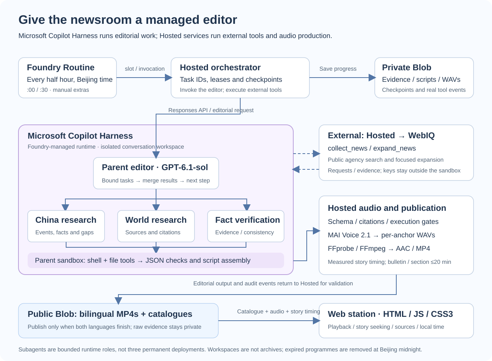
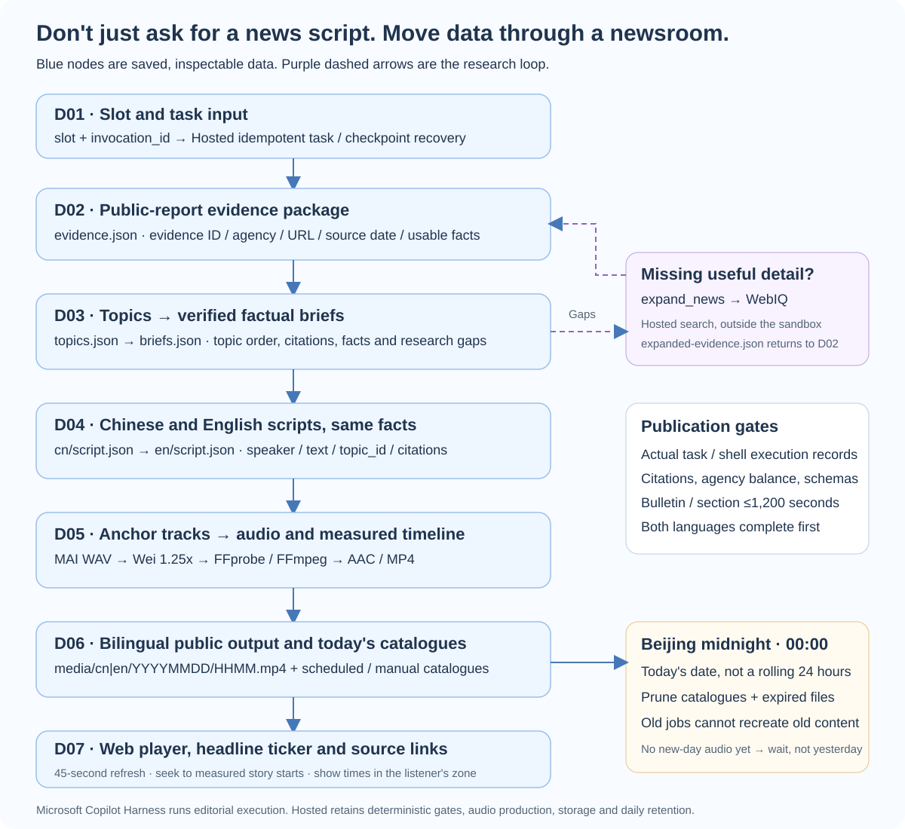

# From Writing Scripts to Running a Newsroom: A 24-Hour News Station with Microsoft Copilot Harness

> A technical evangelist's story about moving AI beyond answers and into a recoverable, inspectable publishing workflow.
>
> This article reflects the Meridian 24 implementation and official documentation available on November 1, 2026. Microsoft Copilot Harness and MAI Voice 2.1 are both in public preview. Their documentation states that these preview features have no SLA and are not recommended for production workloads. “24-hour” is this application's design goal, not a commercial availability guarantee.

Picture an evening commute. You open a page on your phone and hear two anchors delivering a coherent news bulletin. Headlines and timestamps move across the bottom of the screen. Tap a headline and the audio jumps to that story. Tap its source and the original report opens separately. Switch to English and you hear the same underlying facts—not an unrelated second news selection.

That is the idea behind Meridian 24: a half-hourly China and world news podcast, with Chinese and English audio and a single HTML, JavaScript and CSS3 page.

At first, it sounds like a simple recipe: search for news, ask a model to write a script, and turn the script into speech.

Once we started building, the real challenge became clear. Getting AI to speak was relatively easy. Keeping a small newsroom working responsibly was not.

## 1. Why Introduce Microsoft Copilot Harness?

### The first script needed a better process, not prettier sentences

Give a model a pile of headlines and it can produce a pile of summaries. The stories may not connect. Some search results contain too little detail, inviting the model to fill space with commentary. One agency may dominate simply because its reporting is easier to retrieve.

Another instruction to “sound more professional” does not solve that problem.

We needed an editorial method: collect public reporting, consolidate related events, identify missing details, research those gaps, prepare evidence-backed facts, and only then write a coherent two-anchor programme.

**A model can be a capable editor. A newsroom still needs a workbench, a filing system, task assignments and handovers.**

Microsoft Copilot Harness supplies a managed execution foundation for that work. Microsoft Foundry operates the agent loop and sandbox, coordinates model and tool steps, and supports native subagents, file operations and reusable skills, among other capabilities.[1][2]

Developers can spend less time constructing the newsroom's office equipment and more time teaching it how to do useful work.

### A 22:30 production job should not lose its progress

A bulletin involves retrieval, editorial requests, speech synthesis and audio encoding. If the service stops after ten speech segments have already been synthesized, starting everything again wastes time and money.

Two capabilities matter here, and they should not be confused.

**Microsoft Copilot Harness** operates the managed editorial runtime. **Long-running resilience for Hosted Agents** provides a foundation for restarting interrupted work. The application still decides what progress to save, how to resume and how to prevent duplicate publication.[1]

We therefore did not put the entire station into one prompt. Nor did we interpret “managed” as “nothing left to engineer.”

## 2. How Do We Build the Application with Microsoft Copilot Harness?

### A managed editor, with a separate audio production room

The existing Hosted service already knew how to call WebIQ, invoke speech synthesis, run FFmpeg and write to Blob. Instead of replacing it, we kept those deterministic responsibilities there and created a separate Prompt Agent using Microsoft Copilot Harness for research and editing.



*Figure 1: The purple boundary contains managed editorial execution. WebIQ and audio production run in external Hosted services. Important results are stored in Blob, not entrusted to a permanently available sandbox.*

Microsoft Copilot Harness owns the editorial execution: researching, organizing, delegating and drafting. Hosted code owns external API execution, validation, synthesis and publication.

That boundary is also a practical preview requirement. You cannot switch an existing agent to a different harness during the initial public preview. We created a new editor and retained the original Hosted Agent's type and responsibilities.[2]

Here is an abbreviated excerpt from the project's definition, omitting the full instructions and custom news tools:

```yaml
kind: prompt
name: newsradio24-editor
model: gpt-6.1-sol
harness:
  type: microsoft_copilot_preview
tools:
  - type: microsoft_copilot_toolset_preview
    defaultConfig:
      enabled: false
    configs:
      - name: filesystem_read
        enabled: true
      - name: filesystem_write
        enabled: true
      - name: shell
        enabled: true
      - name: subagents
        enabled: true
```

`gpt-6.1-sol` is the model deployment name used in this project, not a promise that it is available in every project. Use a supported model already deployed in your own project region. See the full [newsroom.yaml](../agents/newsroom.yaml), and check official documentation for current preview fields and supported tools.

### Subagents are backstage editors, not extra presenters

The audience still hears just two anchors. Behind the scenes, the work has three logical roles:

| Subtask role | Input | Output |
| --- | --- | --- |
| China research | China reporting and evidence IDs | Consolidated events, facts and research gaps |
| World research | International reporting and agency coverage | Topic order, citations and expansion needs |
| Fact verification | Expanded evidence, briefs or scripts | Citation checks, conflicts and bilingual consistency issues |

The parent editor delegates bounded tasks and merges their results. This project allows at most three subtasks per editorial request. These are not three separately deployed, permanently running services, nor an identical fixed trio instantiated in every phase.

The sandbox acts as an editor's workbench: shell and file tools help organize JSON and inspect evidence IDs and topic order. Each conversation has a separate workspace, but that workspace is not a durable archive. Important outputs belong in durable storage.[2]

The station currently describes its method through version-controlled instructions and request-level procedures. **It has not published those procedures as separate Foundry Skills.** Reusable skills are a supported extension opportunity, not something we should claim this implementation already uses.

### Let tools bring evidence, not credentials

The editor requests discovery and expansion through `collect_news` and `expand_news`. Both accept an empty object. The server binds the news window and context, and the WebIQ key remains in the Hosted service.

When an external function call arrives, Hosted code executes the search and returns a `function_call_output` with the matching `call_id` in the same conversation. The editor can continue without receiving credentials.

This excerpt shows only the editorial request entry point—not the full tool-execution loop. `payload` carries the phase's procedure, evidence and output contract:

```python
import json
import os
from azure.ai.projects.aio import AIProjectClient
from azure.identity.aio import DefaultAzureCredential

async def request_editor(payload):
    async with (
        DefaultAzureCredential() as credential,
        AIProjectClient(
            endpoint=os.environ["FOUNDRY_PROJECT_ENDPOINT"],
            credential=credential,
            allow_preview=True,
        ) as project,
        project.get_openai_client(
            agent_name="newsradio24-editor",
            timeout=900,
            max_retries=2,
        ) as client,
    ):
        conversation = await client.conversations.create()
        return await client.responses.create(
            conversation=conversation.id,
            input=json.dumps(payload, ensure_ascii=False),
        )
```

The project uses `azure-ai-projects` 2.9.0. Read your own project endpoint from a server-side environment. Never put keys, real resource-group names or complete environment files into an article, browser code or sandbox. The complete adapter is in [harness.py](../src/resilient-research/station/harness.py).

## 3. Where does it offer an advantage over a typical self-built agent harness?

As a technical evangelist, I prefer describing the responsibility it removes rather than implying that nobody else can implement these capabilities.

Open-source frameworks and custom systems can also support tools, delegation, state management and sandboxes. The distinction is that Microsoft Copilot Harness delegates part of that execution infrastructure to Foundry and connects it with the platform's agent definitions, identity and tool configuration.

| Question | Typical self-built approach | Microsoft Copilot Harness |
| --- | --- | --- |
| Who maintains the internal model/tool loop? | Your team builds it or operates a framework runtime | Foundry operates that runtime |
| How are files, commands and subtasks integrated? | Your team assembles execution and delegation mechanisms | Use supported native capabilities |
| How are agent definitions delivered? | Establish your own configuration and release conventions | Version declarative definitions alongside application code |
| How is tool access governed? | Depends on your framework and integrations | Connect with Foundry roles, agent identity and connections |
| How much runtime control is available? | Greater control, with greater maintenance responsibility | Less runtime operation, within supported capabilities and preview limits |

For a news station, that trade-off leaves more engineering time for evidence quality, editorial coherence and listening experience.

It does not make reporting automatically true, remove permission configuration or support arbitrary models and tools. If you need to control the framework, dependencies, process model or specialized middleware, a Hosted Agent remains a sensible choice.[1][2]

Costs do not disappear either. Inference, speech, retrieval, storage, traffic and runtime usage require a budget. Consult current regional service pricing and your agreement.

**The advantage is not “all engineering done for you.” It is a clearer opportunity to spend engineering effort on what makes your application different.**

## 4. What Techniques Matter Most When Building a 24-Hour News Station?

### Turn reporting into facts before turning facts into sound

Our production flow does not send raw search results directly to speech synthesis. It produces explicit intermediate deliverables:



*Figure 2: Each blue node has an inspectable data shape. Research gaps trigger an expansion loop. Editorial execution and audio production have separate validation gates.*

WebIQ searches public reporting from Xinhua, AP, AFP and Bloomberg. We check sources and dates. Homepages, advisories and headline-only results are discovery leads, not sufficient factual evidence.

Related reports become topics. Missing details become targeted searches. If expansion still does not find enough evidence, shorten or omit the story rather than fill the silence with opinions. A section without sufficient facts should prevent publication.

“Trending” also needs an honest definition: this implementation selects using relevance, recency and cross-source coverage. It does not possess a measured audience-popularity leaderboard.

### Agency balance must come from evidence, not relabeling

Early programmes leaned toward Xinhua because more usable reporting was available. The answer was not to label those stories “AP.” We reserved candidate space for underrepresented agencies and added bounded expansion searches.

Final selection keeps at most two China topics and four world topics. When at least two reliable non-Xinhua topics are selected, Xinhua is capped at half the programme. Sparse evidence may still produce an uneven mix. The page reports actual sources rather than inventing four-agency coverage.

Neutrality is not achieved by asking the male and female anchors to exchange opposing opinions. They complement each other with cited facts and background, finish one story before moving on, and use transitions without manufacturing debate.

### Two languages should share one factual foundation

If Chinese and English select stories independently, they can become different programmes.

We prepare an ordered factual brief, draft the Chinese body, and adapt the English version from the same brief and Chinese content. Deterministic code adds introductions, AI-voice disclosure, greetings and polite sign-offs rather than hoping the model remembers every time.

The Chinese anchors use MAI Voice 2.1's Wei and Mei; English uses Grant and Harper. The station has no sports section or third anchor.[3]

### “The voice is too slow” turned out to be a timing problem too

Wei's Chinese delivery needed more pace. Instead of accelerating the entire programme in the browser, we applied pitch-preserving `1.25x` tempo to Wei's synthesized tracks on the server. Mei and both English anchors remain at `1.0x`.

That decision requires measuring the processed tracks again before calculating story starts, assembling audio and encoding it. Otherwise, a “jump to story two” button may land in the wrong sentence.

WAVs are working files. The final MP4 contains real AAC audio; it is not an MP3 with a different extension. The complete bulletin and every section must remain within 1,200 seconds, measured from actual audio. Oversized output is rejected, not cut in the middle of a sentence.

### Inspect the handover sheet, not the AI's claim of completion

The station stores records for collection, topic organization, expansion, final briefs, Chinese scripts and English scripts. All four editorial phases must actually execute native subtasks and shell operations. A response saying “I checked it” is not sufficient.

Here is an abbreviated illustration of two gates. Production checks runtime records per phase and duration after audio production:

```python
observed = harness.native_tools(response_outputs)
if not {"task", "shell"} <= observed:
    raise RuntimeError("Missing native editorial execution")

audio.check_duration(chapters, total_seconds)
```

Native subtasks and shell operations run through the platform. They must not be mistaken for unresolved external functions that Hosted code still needs to execute. The implementation uses actual response events and `call_id` pairing, not the model's self-assessment.

In one completed end-to-end run, Chinese audio measured **268.1 seconds** and English **271.0 seconds**. Verification covered all six phase records and story starts derived from actual WAVs. Those are results for one particular edition—not guarantees of future latency, quality or availability.

Passing these gates establishes structural, citation and execution conditions. It is not proof of truth or semantic neutrality. Human editorial review still matters.

### Put recovery into the data and publication into a handover

Completed evidence, scripts, WAVs and status live in private Blob storage. A resumed task reads checkpoints and reuses synthesized tracks rather than repeating every completed action.

Only after Chinese and English are complete does a publication lease protect the catalogue update. One write reveals both outputs. Scheduled editions and manual extras have separate catalogues, so a manual success cannot be passed off as proof of a successful scheduled run.

We also encountered a very practical deployment hurdle: the Hosted service's **instance identity** lacked project permission to create managed editorial conversations. Assigning Foundry User at the project scope to the correct calling identity, then allowing propagation, resolved it. Your user account having permission does not imply that the running agent has it.[2]

### Midnight is a real handover, not another replay

“Keep one day” requires a shared definition of the day. We use the current `Asia/Shanghai` calendar date—not a rolling 24 hours, and not each visitor's local day for deleting shared Blob content.

A separate task runs at Beijing midnight to prune expired catalogues, public/private audio, evidence, scripts, WAVs and runtime records, including snapshots and stored versions. Each production also sweeps to catch missed cleanup. Dated writes and cleanup share the publication lease, so an old job cannot recreate yesterday's files after deletion.

The browser stops expired audio at rollover even if catalogue refresh fails. If today's first programme is not ready, it waits. Repeating the latest completed programme is allowed only within the current station day.

Cleanup does not silently disable account-wide Azure soft-delete protection. If enabled, recoverable copies remain subject to that policy. Previously downloaded files cannot be recalled.

### The final details live on a phone screen

The frontend needs no elaborate framework: a lightweight single page can offer a persistent player, headline ticker, source links, language switching and current-day listening on demand.

A headline seeks the audio; a source link opens the report. Keeping those actions separate avoids an ambiguous click.

Display all times in the listener's browser timezone while retaining Beijing time for paths and cleanup. Refresh catalogues every 45 seconds. Expect browser autoplay restrictions to require an initial tap. A desktop demonstration is not enough: exercise mobile playback, scrolling, seeking and timezone conversion.

## Closing Thought: A Useful Agent Is More than a Beautiful Answer

The takeaway is not simply that AI can generate a podcast. It is that we gave the station understandable responsibilities, durable data and inspectable handovers.

Microsoft Copilot Harness gives the managed editor tools, a workbench and delegation. Application code protects evidence, permissions, duration, publication and lifecycle boundaries.

That is the agent story I want to tell as a technical evangelist: **bring intelligence into a real workflow, rather than hide the workflow inside a prompt.**

Explore the current programme and interactive data-node diagram on the [Meridian 24 page](https://meridian2498ac2806.z1.web.core.windows.net/?v=10#architecture). The page retains only the current station day's content; it is not a permanent episode archive.

## References

1. [Microsoft announcement: Microsoft Copilot Harness and Hosted Agent long-running resilience](https://devblogs.microsoft.com/foundry/microsoft-copilot-harness-in-foundry/)
2. [Microsoft Learn: Microsoft Copilot Harness, including identity, workspaces and preview limitations](https://learn.microsoft.com/en-us/azure/foundry/agents/how-to/use-tools-skills-copilot-harness)
3. [Microsoft Learn: MAI Voice 2.1 and MAI Voice 2.1 Flash](https://learn.microsoft.com/en-us/azure/ai-services/speech-service/mai-voices)
4. [Project implementation and documentation](../README.md)

*Agency names identify search sources. The station is not affiliated with those agencies. Retrieval access is not a republication licence: generate original, attributed factual summaries, do not bypass paywalls, and do not reproduce source articles.*
